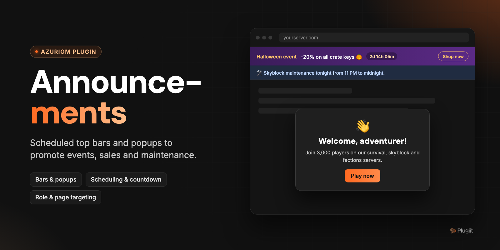

# Plugiit Announcements

Scheduled announcements for Azuriom: bars at the top of every page and modal popups, targeted by audience, role and page.

Azuriom plugin · v1.0.1 · by Plugiit

## Features

- **Two display types**: bars at the top of every page and/or modal **popups**.
- **Markdown or safe simple HTML** messages. HTML goes through an allow-list (`strong`, `em`, `a`, `br`, `p`, `ul`, `ol`, `li`, `code`, etc.); scripts, event attributes and `javascript:` links are removed.
- **Styles**: information, success, warning, danger or custom colors (background + text).
- **Optional action button** (label + absolute or relative link).
- **Scheduling** with start and end dates, plus an optional **countdown** until the end date (the bar disappears on its own when it ends).
- **Audience targeting**: everyone, guests, logged-in members or specific roles.
- **Page targeting**: all pages, home page, shop or URL patterns (`forum/*`, `vote`, `/` for the home page, etc.).
- **Dismissible bars**: the choice is stored in the visitor's browser (`localStorage`) per announcement **and version**. Editing the title, message or button shows the announcement again.
- **Popup frequency**: only once, once per browsing session or on every page load.
- **Priority**: orders the bars and picks the popup. Only **one popup per page load** is shown: the highest-priority one not already seen.
- **Multiple active bars**: **stacked** or **rotating** (configurable delay, paused on hover and focus, navigation dots).
- **Plays well with Plugiit Cookie Consent**: when it is installed, the popup waits until the visitor has answered the cookie banner, so two windows never stack.
- **Cached** active announcements, invalidated on every creation, update or deletion.
- **Accessible**: ARIA region, modal with trapped focus, Escape to close, labelled buttons.
- Action log entries for announcements (created, updated, deleted) and settings changes.
- English and French translations.

## Requirements

- Azuriom `1.1.0` or later (`azuriom_api` 1.1.0).

## Installation

**From the Azuriom Market** (recommended): install and enable the plugin from **Admin → Plugins**.

**Manually**:

1. Copy the plugin into the `plugins/` directory of your Azuriom installation. The folder **must be named after the plugin ID**, not after the repository:

   ```
   plugins/plugiit-announcements/
   ```

2. Enable the plugin from **Admin → Plugins**. The migrations create the `plugiit_announcements` table.
3. Create your announcements in **Admin → Announcements**.

## Configuration

### Permission

| Permission | Description |
| --- | --- |
| `plugiit-announcements.admin` | Manage announcements (bars and popups) |

### Admin pages

| Page | URL |
| --- | --- |
| Announcements list | `/admin/plugiit-announcements/announcements` |
| Create an announcement | `/admin/plugiit-announcements/announcements/create` |
| Settings | `/admin/plugiit-announcements/settings` |

The announcements list shows the status of each announcement: running, scheduled, ended or disabled.

### Announcement fields

| Group | Fields |
| --- | --- |
| Content | Title (max. 150), message (max. 5000), format (Markdown / simple HTML), button text and link |
| Display | Type (bar / popup), style, custom background and text colors, dismissible, popup frequency, priority (-100 to 100), enabled |
| Schedule | Start, end (website timezone), countdown until the end date |
| Targeting | Audience (everyone / guests / members / roles), pages (all / home / shop / URL patterns) |

URL patterns: one per line, `*` matches anything. Examples: `vote`, `forum/*`, `shop/categories/*`, `/` for the home page.

### Settings

| Setting | Default | Description |
| --- | --- | --- |
| Display of several active bars | Stacked | `Stacked` or `Rotating` (one bar at a time). |
| Display time of each rotating bar | 6 seconds | Between 3 and 60 seconds. |

## Usage

The plugin has no public page. Announcements are injected by a global middleware into every HTML page (except the admin panel, API, AJAX requests and error pages). Bars are inserted right after `<body>`; popups and the script are added before `</body>`.

### Theme integration

To place the bars elsewhere (for example under the navbar), add this to your theme:

```blade
@include('plugiit-announcements::bars')
```

The automatic bar insertion is then disabled for that page. Popups are still injected automatically.

### JavaScript API

```js
// Fired on document when a popup is closed
document.addEventListener('plugiit-ann:popup-closed', () => { /* ... */ });

// Close the open popup
window.PlugiitAnnouncements.closePopup();
```

### Compatibility

All HTML, CSS classes and IDs are prefixed with `plugiit-ann-`. The script is a dependency-free IIFE. Z-index: bars `1031` (in the page flow), popup `1060`, below a cookie banner at `1080`.

## Known limitations

- Dates are interpreted in the website timezone.
- "Closed" / "already seen" states are stored in the visitor's browser only (no server-side tracking).

## Support

Open an issue on GitHub or contact Plugiit.

## Contributing

Issues and pull requests are welcome.

## License

License: to be defined.
